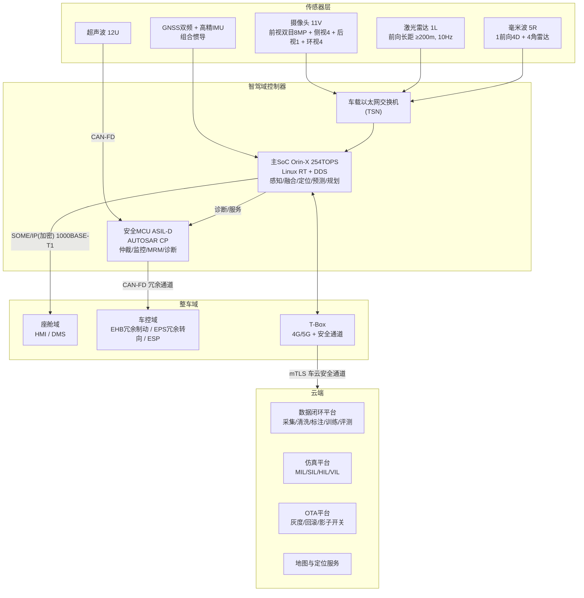
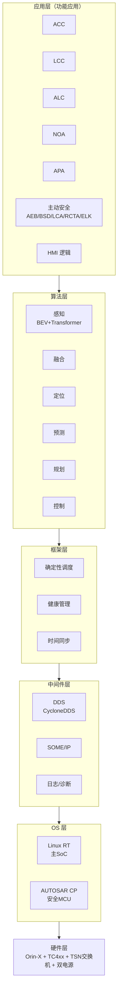
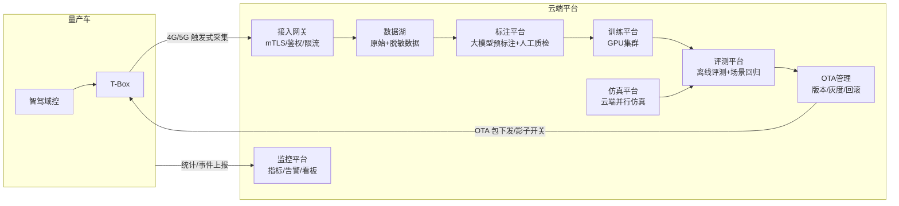
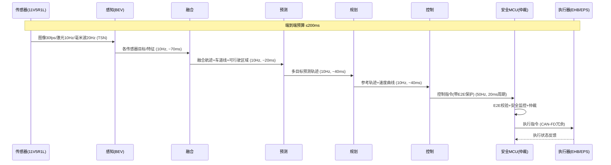
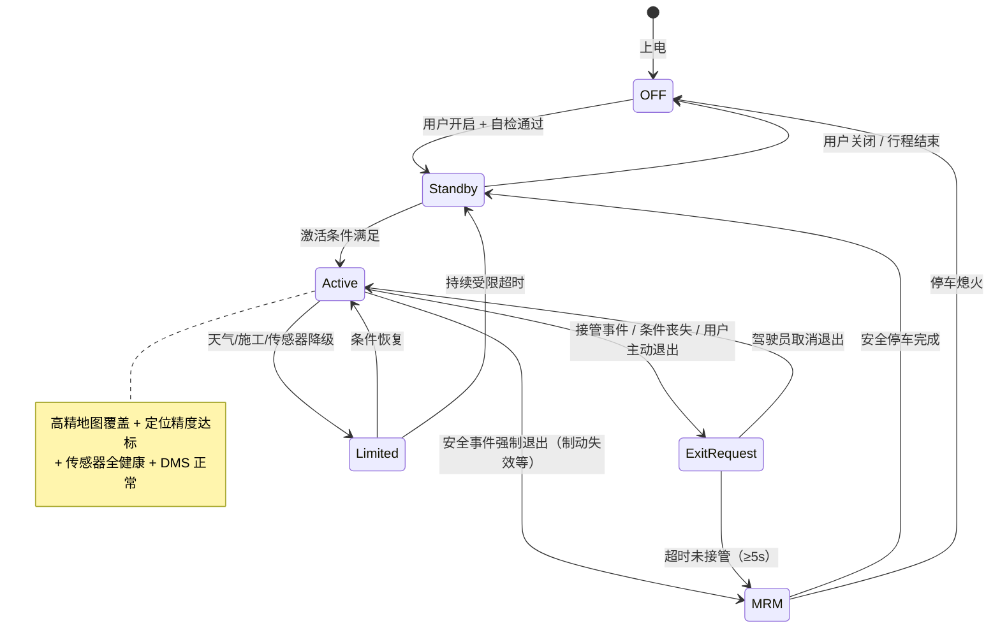
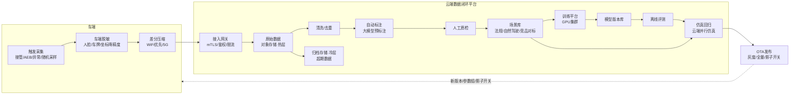
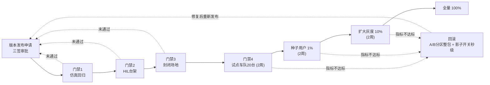
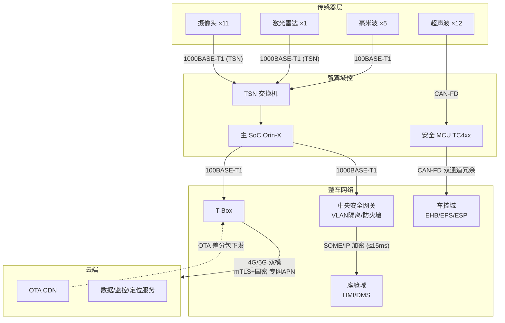
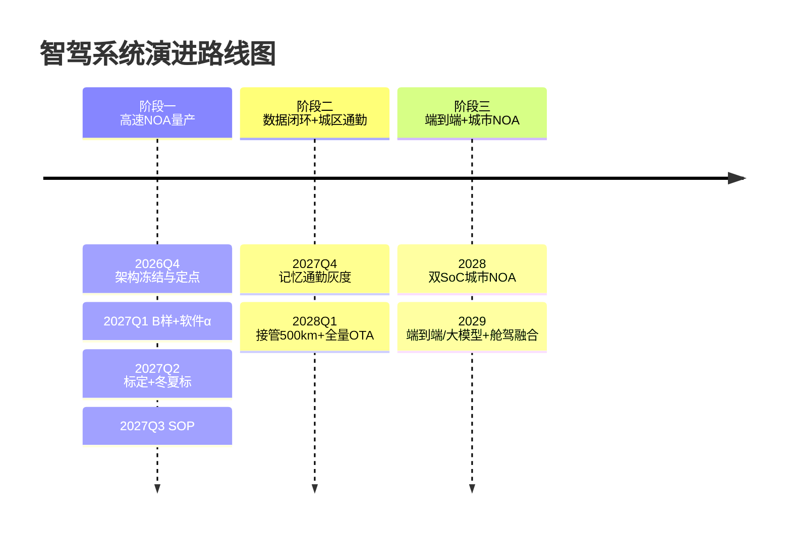

# 楚能汽车智能驾驶系统架构设计方案

**文档编号**：CN-EE-AD-ARCH-001
**版本**：V0.1（评审稿）
**编制**：智能驾驶研发架构团队
**日期**：2026-10-14
**评审范围**：系统整体架构、关键技术选型、方案对比、功能安全与合规、阶段规划
**密级**：内部

## 修订记录

| 版本 | 日期 | 修订内容 | 作者 |
|------|------|----------|------|
| V0.1 | 2026-10-14 | 初稿，供架构评审 | d3y1 |
| V0.2 | 2026-10-14 | 补充 NOA 状态机图、应用架构图、数据闭环架构图、网络拓扑图、灰度发布流程图 | d3y1 |

---

## 文档摘要

楚能汽车首发车型（对标问界 M5 级中型新能源 SUV，2027 年 SOP）智能驾驶系统采用**渐进式融合架构**：

- **ODD 定位**：首发量产高速 NOA + 全场景泊车（P0）；OTA 扩展城区记忆通勤（P1）；预留板级升级至城区 NOA（P2）
- **传感器**：11V5R1L + 12U + 高精组合惯导——前向激光雷达 1 颗用于极端天气鲁棒性与 AEB 能力上限，是"性能/成本"平衡的关键决策点
- **计算平台**：单 Orin-X（254 TOPS）+ 车规安全 MCU（ASIL-D）双通道架构，板级预留第二 SoC；国产芯片双轨备选
- **软件**：BEV+Transformer 感知、DDS+确定性调度中间件（SOME/IP 对接整车 EE）、高速场景交互预测与分层规划
- **安全合规**：ISO 26262 ASIL-D（纵向控制链）、SOTIF（ISO 21448）、信息安全（ISO 21434，复用公司 SOME/IP 加密专利）、ASPICE CL2
- **数据闭环**：触发式采集 + 云端自动标注 + 场景库 + 仿真（MIL/SIL/HIL/VIL）+ OTA 灰度，支撑周级算法迭代
- **成本**：智驾 BOM 目标 1.3~1.5 万元，契合"极致性价比"产品定位

---

## 设计前提与假设

> 本章所列假设为架构设计的输入边界，评审时请优先对齐。凡标注【假设】者以公司正式口径为准。

| 编号 | 假设内容 | 依据 |
|------|----------|------|
| A1 | 首发车型为对标问界 M5 级中型新能源 SUV，目标价格带 15~20 万元，2027 年 SOP | 公开报道"对标问界M5车型明年上市" |
| A2 | 智驾域控与软件算法全栈自研，供应商提供芯片/传感器/基础软件组件 | 公司智驾全链条招聘 |
| A3 | 首发车型采用全新域集中式 EE 架构，无历史平台包袱 | ET 车验证清单含"电子架构" |
| A4 | 生产资质与产能通过盘活存量工厂解决，年产能 15 万台级 | 公开报道，以公司口径为准 |
| A5 | 智驾研发团队 2026Q4 起规模扩充至约 120 人（自研+外包） | 【假设】按 2027 SOP 周期倒排 |
| A6 | 智驾系统 BOM 预算 1.3~1.5 万元 | 【假设】按整车 15~20 万定位与"极致性价比"产品定义推算 |
| A7 | 文中所列 BOM、芯片价格均为量级估算，仅供方案对比，以采购定点为准 | 【假设】 |
| A8 | 高精地图/定位服务以第三方图商合作方式获得 | 【假设】 |

---

## 一、现状

### 1.1 业务背景

**公司概况**

- 楚能（武汉）汽车有限公司成立于 2024-12-26，注册资本 20 亿元（实缴 10 亿元），由恒信汽车集团股份有限公司持股 50%，所属行业为新能源车整车制造。
- 核心研发主体武汉江夏楚能汽车技术研发有限公司成立于 2025-07-09，注册资本 5 亿元，建有研发技术中心、整车测试中心与试制中心。
- 公司背景：电池企业（楚能新能源）跨界造车，自研"珠峰"电池构建三电成本优势；恒信汽车为全国性大型汽车经销商集团，具备渠道与后市场优势。
- 关键里程碑：2026-07-11 首台 ET 工程试制车在江夏下线，首发车型进入实车验证阶段，ET 车覆盖电子架构、三电、智能座舱、智能驾驶、底盘、热管理等核心系统验证。

**业务目标**

- 首发车型 2027 年上市，智能驾驶功能达到市场主流 L2+ 水平，成为产品核心卖点之一；
- 产品定义（董事长公开讲话）：安全舒适、极致性价比、性能卓越——智能驾驶架构设计必须服从成本约束；
- 智驾业务 KPI：中高配车型智驾功能标配/高选装率，高速 NOA 可用里程覆盖全国高速干线，接管里程指标对标行业头部水平。

**核心业务流程描述**

1. 整车开发流程：架构定义 → 零部件定点 → A/B/C 样 → DV/PV 验证 → 冬标/夏标 → SOP；
2. 智驾软件流程：需求 → 开发 → 仿真（MIL/SIL）→ 台架（HIL）→ 实车（VIL/路测）→ 标定 → OTA 发布；
3. 数据闭环流程：车端触发采集 → 脱敏回传 → 云端清洗标注 → 训练 → 离线评测 → 仿真回归 → OTA 灰度发布。

**现有业务痛点分析**

- 竞品（问界、理想、小鹏等）已量产城市 NOA，2027 年上市的首发车型若仅有基础 L2 功能，产品竞争力不足；
- "极致性价比"定位约束智驾 BOM，需在有限成本内实现有竞争力的高速 NOA 体验；
- 数据零积累：感知模型冷启动是最大技术风险之一；
- 0-1 团队：研发体系（ASPICE/功能安全）与工具链需在一年内建立并支撑 SOP。

### 1.2 技术背景

**当前技术栈概述**

- 电子电气架构：全新平台，域集中式起步，具备直接采用新一代 EE 架构的条件（无历史包袱）；
- 智驾系统处于方案定义阶段：域控、传感器、地图与云服务均未定点，本方案即解决此问题；
- 已有技术积累（公司专利）：
  - 《一种基于 SOME/IP 通讯的端到端加密方法及系统》（公开号 CN121585350A）：加密耗时降低 50% 以上，端到端通讯时延控制在 15ms 以内；
  - 《一种应对场景亮度变化的驾驶安全视觉感知方法及系统》（公开号 CN121585917A）；
  - 《一种通信架构生成方法》（公开号 CN120915668A）。

**现有系统架构描述**：智驾系统尚无既有架构，本方案为 0-1 设计。

**基础设施现状**：整车测试中心与柔性数字化试制产线可支撑实车验证；数据闭环平台、仿真平台、OTA 平台待建。

**技术债务与挑战**

| 挑战 | 说明 | 对架构的影响 |
|------|------|--------------|
| 数据冷启动 | 无自采数据积累 | 架构须内置数据闭环，仿真先行 + 外采数据补位 |
| 周期紧 | 2027 SOP 倒推约 12 个月 | 功能分级（MoSCoW），首发范围收敛到高速 NOA |
| 体系空白 | ASPICE/功能安全流程待建 | 架构设计即嵌入安全生命周期，安全团队早期介入 |
| 供应安全 | 高端芯片供应不确定性 | 双供应商策略 + 算法跨平台抽象层 |

**现有系统性能指标**：不适用（方案阶段），基线目标见第二章需求。

---

## 二、需求

### 2.1 业务需求

**功能需求列表**（P0=SOP 首发必达；P1=OTA 交付；P2=规划）

| 编号 | 功能 | 说明 | 优先级 |
|------|------|------|--------|
| F01 | ACC 自适应巡航 | 全速域，含 stop&go | P0 |
| F02 | LCC 车道居中 | 含弯道自适应降速 | P0 |
| F03 | ALC 拨杆变道 | 用户确认式变道 | P0 |
| F04 | NOA 高速导航辅助驾驶 | 高速/城市快速路：自动上下匝道、自主变道、大车避让、施工区处理 | P0 |
| F05 | AEB 自动紧急制动 | 车/行人/骑行者，C-NCAP 2024 高分导向 | P0 |
| F06 | 主动安全套件 | BSD、LCA、DOW、RCTA、ELK、FCTA | P0 |
| F07 | APA 自动泊车 | 融合视觉+超声，垂直/水平/斜列 | P0 |
| F08 | 城区记忆通勤 | 单用户固定通勤路线记忆行车 | P1 |
| F09 | HPA 记忆泊车 | 固定车位记忆泊入/泊出 | P1 |
| F10 | 城区 NOA 扩展 | 红绿灯识别通行、无保护转向 | P2（需硬件升级） |

**业务目标与 KPI**

| KPI | 目标值 | 说明 |
|-----|--------|------|
| 高速 NOA 可用里程覆盖率 | ≥95%（全国高速干线） | 高精地图覆盖 + 功能可用性 |
| 高速 NOA 平均接管里程 | 首发 ≥200km/次；OTA 6 个月后 ≥500km/次 | 头部水平对齐 |
| AEB 性能 | C-NCAP 2024 主动安全得分率 ≥95% | 含夜间/雨天场景 |
| 智驾配置率 | 中高配标配，整体 ≥60% | 产品竞争力 |
| 智驾 NPS | 行业头部水平 | 用户体验导向 |

**用户场景分析**

| 场景 | 频率 | 核心诉求 | 对应功能 |
|------|------|----------|----------|
| 高速长途 | 低频高价值 | 减轻疲劳、安全 | NOA、ACC/LCC、AEB |
| 城区通勤 | 高频 | 固定路线省心 | 记忆通勤（P1） |
| 泊车 | 高频 | 狭窄车位 | APA/HPA |

### 2.2 业务痛点

（与 1.1"现有业务痛点分析"合并，此处不重复展开。）

### 2.3 性能需求

> 注：模板中"响应时间/吞吐量/并发用户数"等互联网指标在此替换为车规实时性/算力/功耗等指标。

**实时性指标**

| 指标 | 目标值 |
|------|--------|
| 传感器输入 → 执行指令端到端时延 | ≤200ms（典型工况）；≤250ms（最坏工况） |
| 控制指令周期 | ≤20ms（50Hz，横纵向解耦） |
| 规划周期 | ≤100ms（10Hz） |
| 感知目标输出频率 | ≥10Hz；摄像头输入 ≥30fps，激光雷达 10Hz，毫米波 20Hz |
| 数据到达延迟抖动 | ≤5ms（TSN 确定性传输） |
| SOME/IP 域间安全通信时延 | ≤15ms（公司专利指标） |

**算力/资源指标**

| 指标 | 目标值 |
|------|--------|
| 主 SoC 峰值算力利用率（量产版本） | ≤70%，为 OTA 模型升级预留 ≥30% 余量 |
| 内存/带宽余量 | ≥30% |
| 域控典型功耗 | ≤80W（方案3），峰值 ≤120W |
| 启动时间 | 冷启动至 ACC 可用 ≤30s；至 NOA 可用 ≤60s |

**可靠性与安全指标**

| 指标 | 目标值 |
|------|--------|
| 随机硬件失效率（安全目标相关） | PMHF < 10⁻⁸/h，满足 ASIL-D |
| 单点故障覆盖（安全机制） | ≥99%（ASIL-D） |
| 基础功能（ACC/AEB）单次行程可用率 | ≥99.9% |
| NOA 功能可用率 | ≥95%（受天气/道路条件约束） |
| AEB 误触发率 | 目标接近 0 次/百万公里 |

**扩展性需求**：硬件板级预留双 SoC；软件架构支持城市 NOA 算法迭代与端到端模型演进而无需重构；支持跨车型平台复用（域控软硬件平台化）。

### 2.4 合规需求

| 体系/标准 | 要求 |
|-----------|------|
| ISO 26262:2018（GB/T 34590） | 纵向控制链 ASIL-D；横向控制链 ASIL-B（经 ASIL-D 分解，下称 B(D)）；完整安全生命周期证据链 |
| ISO 21448:2022（SOTIF） | 感知触发条件分析、已知/未知场景验证、残差风险论证 |
| ISO 21434:2021 | TARA 分析、HSM、SecOC、安全启动、安全 OTA |
| ASPICE 4.0 | 智驾软件项目达成 CL2 |
| 法规/评级 | GB 17675（转向）、GB 21670（制动）、UN R152（AEB）、C-NCAP 2024 及 2027 前瞻、UN R79 |
| 数据合规 | 《个人信息保护法》《汽车数据安全管理若干规定（试行）》：车外人脸/车牌脱敏、数据分类分级、出境限制、测绘相关资质 |

---

## 三、方案描述

### 3.1 方案1：旗舰全冗余方案（双 SoC + 2L，全域 NOA-ready）

#### 3.1.1 概述

**核心思想**：一步到位构建 Fail-Operational 能力，首发即覆盖高速 + 城市全域 NOA，架构三年不落后。

**技术选型依据**：双 SoC 互为冗余满足 L2++/L3 预备的可用性要求；2 颗激光雷达（前向 + 补盲/尾部）最大化极端天气与异形障碍物感知能力。

**架构设计理念**：以性能天花板换取时间窗口，用硬件冗余覆盖 0-1 团队算法成熟度不足的风险。

#### 3.1.2 详细说明

| 维度 | 配置 |
|------|------|
| 传感器 | 11V（前视双目+侧视4+后视1+环视4，DMS 与座舱共享）5R 2L 12U + 双频 GNSS/高精 IMU |
| 计算平台 | 2× Orin-X（508 TOPS）+ 独立安全 MCU；双 SoC 异构冗余（感知双冗余 + 规划热备） |
| 软件 | 城市级 BEV+Occupancy 感知、全场景交互预测、规则+学习混合规划 |
| 冗余等级 | Fail-Operational：转向/制动/供电/通信全冗余 |
| ODD | 高速 + 城市全域 NOA，无地图限制版本 |

**数据流**：传感器 → 双 SoC 并行感知 → 融合仲裁 → 预测规划（热备）→ 控制 → MCU 仲裁 → 冗余执行器。

**接口设计**：同方案3（见 4.4），增加双 SoC 间同步链路（10G 以太网）。

#### 3.1.3 性能目标

- 城市 NOA 平均接管里程：首发 ≥100km/次，12 个月后 ≥300km/次；
- 算力利用率首发 ≤70%（满足 2.3 节需求上限），城市模型 OTA 升级后趋紧；
- 极端天气（暴雨/雾）NOA 可用性显著高于单激光方案。

#### 3.1.4 性能评估

- 评估方式：HIL + 万台级仿真场景回归 + 城市实测；
- 瓶颈分析：双 SoC 时间同步与结果一致性仲裁是工程难点；城市场景算法与验证工作量约为高速的 3~5 倍，是最大周期风险点。

#### 3.1.5 方案优缺点

| 优势 | 劣势 |
|------|------|
| 性能天花板最高，直接支持城市 NOA | BOM 约 2.2~2.5 万元，与"极致性价比"定位冲突 |
| 冗余等级高，具备 L3 预备能力 | 功耗峰值约 150W，热管理/续航代价 |
| 硬件冗余缓解算法不成熟风险 | 0-1 团队 12 个月内驾驭全域城市场景风险极高 |
| 技术品牌价值高 | 芯片供应与成本波动风险放大（2 颗大算力 SoC） |

**适用场景**：高价位旗舰车型（25 万+）、明确 L3 路线图的企业。

### 3.2 方案2：轻量纯视觉方案（单 SoC + 1R，极致性价比）

#### 3.2.1 概述

**核心思想**：纯视觉 BEV + 单颗中算力 SoC，将智驾 BOM 压至万元以内，以最低成本实现高速 NOA。

**技术选型依据**：视觉信息密度最高、传感器成本最低；去掉激光雷达是最大降本项。

**架构设计理念**：以算法能力替代硬件冗余，最大化"性价比"标签。

#### 3.2.2 详细说明

| 维度 | 配置 |
|------|------|
| 传感器 | 11V（前视双目8MP+侧视4+后视1+环视4）+ 1 前向 4D 毫米波 + 12U + GNSS/IMU |
| 计算平台 | 单 SoC（Orin-N 84 TOPS 或 J6M 级）+ 安全 MCU |
| 软件 | 纯视觉 BEV 感知、单目深度估计、轻量预测规划 |
| 冗余等级 | Fail-Safe：单点故障后依赖驾驶员接管 |
| ODD | 高速 NOA + 泊车；城区仅记忆通勤（受感知上限约束） |

**数据流**：视觉为主 → BEV → 预测规划 → 控制 → MCU 仲裁 → 执行器（无冗余执行）。

#### 3.2.3 性能目标

- 高速 NOA 接管里程首发 ≥150km/次；
- 算力利用率首发约 65%，OTA 升级余量有限；
- 域控功耗 ≤40W。

#### 3.2.4 性能评估

- 评估方式：HIL + 仿真 + 高速实测；
- 瓶颈分析：极端天气（暴雨/大雾/逆光）视觉感知鲁棒性是硬约束；AEB 上限受视觉测距精度限制；单 SoC 无算法升级余量，2028 年模型迭代即触及天花板。

#### 3.2.5 方案优缺点

| 优势 | 劣势 |
|------|------|
| BOM 最低（约 0.9~1.1 万元） | 极端天气感知鲁棒性差（点名攻关点） |
| 周期最短、功耗最低 | 纯视觉链路 ASIL-D 达成难度大、认证风险高 |
| 供应链最简 | AEB 能力上限与 C-NCAP 高分目标存在张力 |
| 契合极致性价比 | 2028 年后竞争力衰减快，硬件升级需换域控 |

**适用场景**：A0/A 级入门车型、成本极度敏感市场。

### 3.3 方案3：渐进式融合方案（单 SoC + 1L，推荐）

#### 3.3.1 概述

**核心思想**：以"1 颗激光雷达 + 单 Orin-X"为性价比最优解，首发高速 NOA 保交付，OTA 扩展城区记忆通勤，板级预留双 SoC 使 2028 年城市 NOA 可平滑升级。

**技术选型依据**：

- **1L 是性能/成本拐点**：单颗前向激光雷达（半固态，约 2500~3000 元）即显著提升极端天气鲁棒性与 AEB 上限，是 点名瓶颈"极端天气感知鲁棒性"的架构级答案；2L 的边际收益递减；
- **单 SoC 控成本**：Orin-X 254 TOPS 满足高速 NOA（利用率约 50%）并预留 OTA 模型升级；板级预留第二 SoC 焊位与互联接口，升级为换板不改软件架构；
- **渐进 ODD 控风险**：城市场景算法与验证工作量 3~5 倍于高速，分阶段交付匹配 0-1 团队成长曲线。

**架构设计理念**：安全靠"异构冗余 + 双通道"而非堆硬件；演进靠"接口稳定 + 能力分层"。

#### 3.3.2 详细说明

**系统架构图**



**应用架构图（软件分层）**



> 各层职责：应用层承载功能状态机（ACC/LCC/ALC/NOA/APA）与 HMI 逻辑；算法层为感知/融合/定位/预测/规划/控制；框架层提供确定性调度、健康管理、时间同步；中间件层承载 DDS、SOME/IP 与诊断；OS 层为主 SoC（Linux RT）与安全 MCU（AUTOSAR CP）双载体；硬件层为域控板卡。

**核心组件设计**

| 组件 | 职责 | 关键设计 |
|------|------|----------|
| 感知-视觉 | 2D 检测/BEV 特征/车道线/交通标志/通用障碍物 | 前视双目 + BEV 融合，极端天气退化为激光+毫米波通道 |
| 感知-激光 | 目标检测/异形障碍物/可行驶区域 | 独立目标级输出，与视觉异构冗余（非简单叠加） |
| 感知-毫米波 | 速度精确测量/雨雾穿透 | 前向 4D 提供高度信息，与视觉/激光交叉验证 |
| 融合 | 多源目标关联、航迹管理、置信度评估 | 传感器健康感知：根据天气/传感器状态动态调整融合权重 |
| 定位 | 高精组合惯导 + 地图匹配 + 视觉/激光定位 | 隧道内惯性递推 + 轮速，丢失降级策略见 4.5 |
| 预测 | 多目标轨迹预测 | 首发高速版为轻量交互预测；城区版增强博弈建模（P1/P2） |
| 规划 | 行为决策（规则）+ 轨迹优化（学习） | 分层设计保证可解释性与安全审查可行性 |
| 控制 | 横纵向解耦控制（LQR/MPC） | 20ms 周期，E2E 保护，安全 MCU 二次仲裁 |
| 安全监控 | 传感器/算法/SoC 健康、功能边界监控 | 独立于性能通道，ASIL-D |

**数据流设计**

运行时主数据流（详见 4.3 时序图）：传感器 → 感知 → 融合 → 预测 → 规划 → 控制 → 安全 MCU 仲裁 → 执行器；全链路 E2E 保护（CRC + 计数器）。

**接口设计**

- 传感器直连域控（1000BASE-T1/100BASE-T1），激光/前视走 TSN 确定性链路；
- 域控 ↔ 座舱：SOME/IP（公司加密专利），1000BASE-T1；
- 域控 ↔ 车控：CAN-FD 双通道冗余（MCU 直连执行器）；
- 域控 ↔ 云端：T-Box 中继，mTLS + 国密；
- 智驾内部：DDS Topic（详见 4.4 接口规范表）。

#### 3.3.3 性能目标

| 指标 | 目标值 |
|------|--------|
| 高速 NOA 接管里程 | 首发 ≥200km/次，OTA 6 个月后 ≥500km/次 |
| 算力利用率 | 首发 ≤50%，OTA 升级后 ≤70% |
| 端到端时延 | ≤200ms 典型 / ≤250ms 最坏 |
| 域控功耗 | 典型 80W / 峰值 120W |
| BOM | 1.3~1.5 万元 |

#### 3.3.4 性能评估

- **性能测试方案**：四级仿真（MIL/SIL 验证算法、HIL 验证域控实时性、VIL 验证整车集成）+ 实车路测（含冬标/夏标/雨雾专项）；
- **预期性能结果**：高速 NOA 时延预算：感知 60~80ms + 融合 20ms + 预测 30~40ms + 规划 40ms + 控制 20ms ≈ 170~200ms，满足 200ms 典型目标（最坏工况 250ms 兜底）；
- **瓶颈分析**：①BEV 推理耗时是时延主项，需 TensorRT 量化优化 + 算子定制；②单 SoC 为单点，故障时 Fail-Safe（人工接管），非 Fail-Operational；③算力余量在 2028 年城区模型升级后趋紧——由板级双 SoC 升级路径解决。

#### 3.3.5 方案优缺点

| 优势 | 劣势 |
|------|------|
| 1L 补齐极端天气鲁棒性与 AEB 上限，性价比最优 | 单 SoC 故障需人工接管（L2+ 法规允许，体验有损） |
| BOM 可控，契合"极致性价比"定位 | 城市全域 NOA 需 2028 年板级升级 |
| 分阶段 ODD 匹配 0-1 团队能力，周期风险最低 | 首发无城市 NOA，营销叙事弱于方案1 |
| 软件架构支持升级（换板不改软件） | 数据闭环冷启动仍需大量投入 |

**适用场景**：15~25 万级主力车型、0-1 新团队、成本敏感但需有竞争力高速 NOA——即楚能首发车型场景。

### 3.4 方案对比

**技术对比矩阵**

| 维度 | 方案1 旗舰全冗余 | 方案2 轻量纯视觉 | 方案3 渐进式融合（推荐） |
|------|------------------|------------------|--------------------------|
| 传感器 | 11V5R2L12U | 11V1R12U | 11V5R1L12U |
| 算力 | 508 TOPS（双 Orin-X） | 84~128 TOPS | 254 TOPS（单 Orin-X，可升级双片） |
| 冗余等级 | Fail-Operational | Fail-Safe | Fail-Safe（关键执行冗余） |
| 首发 ODD | 高速+城市全域 | 高速 | 高速+泊车；OTA 城区通勤 |
| 极端天气鲁棒性 | 最强 | 弱（点名风险） | 强（1L+毫米波异构冗余） |
| AEB 能力上限 | 高 | 中低 | 高 |
| 2028 扩展性 | 好（余量大） | 差（需换域控） | 好（板级升级） |
| 技术成熟度风险 | 高（城市场景量级） | 低 | 中 |
| 开发周期风险 | 高 | 低 | 低 |

**成本对比分析**（量级估算，单位：万元/车）

| 项 | 方案1 | 方案2 | 方案3 |
|----|-------|-------|-------|
| 域控总成 | ~0.9 | ~0.35 | ~0.6 |
| 传感器 | ~1.0 | ~0.35 | ~0.55 |
| 组合惯导+定位服务 | ~0.3 | ~0.2 | ~0.25 |
| 合计 BOM | ~2.2~2.5 | ~0.9~1.1 | ~1.3~1.5 |
| 对整车毛利率影响（15~20 万车） | 显著 | 低 | 可控 |

**风险对比分析**

| 风险 | 方案1 | 方案2 | 方案3 |
|------|-------|-------|-------|
| 成本风险 | 高 | 低 | 低 |
| 周期风险 | 高 | 低 | 低 |
| 安全认证风险 | 中 | 高（纯视觉 ASIL-D 难） | 低 |
| 竞争力风险（2028） | 低 | 高 | 低 |

**推荐方案：方案3（渐进式融合方案）**

理由：
1. **性能-成本-周期三角平衡最优**：以方案2 的 1.5 倍成本获得方案1 的多数核心能力（极端天气、AEB 上限），是"极致性价比"定位下单位成本体验最大化；
2. **1L 直击 痛点**：极端天气感知鲁棒性是 明确点名的量产瓶颈，激光雷达是当前最可靠的架构级解；
3. **风险曲线匹配公司现状**：0-1 团队 + 12 个月周期，分阶段 ODD 收敛交付风险；板级预留保证 2028 年面对城市 NOA 竞争时可升级而不重构软件；
4. **供应链韧性**：双供应商（英伟达/国产芯片）双轨策略可行，算法跨平台抽象层支持快速移植（跨平台算法移植优化）。

---

## 四、量产方案（方案3 深化设计）

### 4.1 架构图

整体架构图见 3.3.2。部署架构图见第五章。补充**车云一体化架构**：



### 4.2 关键设计点和设计折衷

| 编号 | 设计决策 | 理由 | 权衡 |
|------|----------|------|------|
| D1 | 主芯片 Orin-X + 安全 MCU TC4xx | Orin-X 量产成熟、生态完善、254TOPS 满足高速 NOA 且留升级余量 | 备选国产 SoC（J6M 级）双轨开发：算法通过计算抽象层与芯片解耦，保障供应安全（响应 "跨平台算法移植优化"） |
| D2 | 中间件：量产 DDS（CycloneDDS）+ 确定性调度；SOME/IP 对接整车；ROS2 仅用于研发/仿真 | DDS 发布订阅匹配智驾数据流、车规实践丰富；SOME/IP 服务化对接整车 EE；ROS2 生态利于算法快速原型但量产实时性/认证不成熟 | 统一 IDL 接口规范，保证研发（ROS2）→ 量产（DDS）平滑迁移，避免两套接口漂移 |
| D3 | 地图：高速用高精地图 + 高精定位服务；城区记忆通勤用端侧建图 | 高速高精地图保障首发交付可靠性；城区走轻图/无图路线避免测绘资质与成本问题 | 架构预留 SD+ 演进：感知不依赖地图要素，2028 年可切轻图降成本 |
| D4 | 感知：BEV+Transformer 主感知，激光独立目标级异构冗余 | BEV 是当前量产主流且支持无图演进；激光独立输出可在视觉失效时兜底 | 双通道融合增加时延与算力开销约 10%，换取极端天气鲁棒性 |
| D5 | 端到端模型：并行研发（影子模式），不首发上车 | 要求跟踪端到端前沿；但 0-1 首发用端到端可解释性/安全论证风险过高 | 规划保持"规则+学习"分层，端到端作为 2028 演进路线（七章） |
| D6 | 安全架构：性能通道 + 安全监控通道分离（SoC 性能 / MCU 安全） | 主流量产安全架构，避免 SoC 上功能安全全量认证成本 | 控制指令由 MCU 做 E2E 校验与仲裁，MCU 可强制 MRM——单点失效即进入安全状态 |
| D7 | 冗余执行：EHB 冗余制动 + EPS 冗余转向 + 双路供电 | 满足"关键执行冗余"，横向 ASIL-B(D)、纵向 ASIL-D | 整车成本增加约 1500~2000 元，为安全目标必需项 |
| D8 | 数据采集：触发式（接管/AEB/异常）+ 脱敏 + WiFi 优先回传 | 控制流量成本与合规风险；脱敏前置到车端 | 上传量约 1~2GB/车/月，冷启动阶段放宽触发阈值换数据量 |
| D9 | OTA：A/B 分区 + 差分 + 影子开关 | 影子开关支持功能级灰度与秒级回滚，优于整包回滚 | 增加启动存储与开发工作量约 5% |

**非功能性需求满足情况**

| 非功能需求 | 设计响应 | 满足度 |
|------------|----------|--------|
| 毫秒级实时性 | TSN + 确定性调度 + 20ms 控制周期 + ≤200ms 端到端 | 满足 |
| ASIL-D | 双通道架构 + E2E 保护 + MCU 仲裁 + 冗余执行 | 满足 |
| SOTIF | 触发条件分析 + 仿真场景库 + 影子模式积累 | 满足 |
| 信息安全 | HSM + 安全启动 + SecOC + SOME/IP 加密（公司专利） | 满足 |
| 成本 | BOM 1.3~1.5 万，单 SoC + 单激光最优拐点 | 满足 |
| 扩展性 | 板级双 SoC 预留 + 统一 IDL + 分层软件架构 | 满足 |
| 可制造性 | 域控平台化（跨车型复用）、标准接插件、自动装配适配 | 满足 |

### 4.3 业务流程

**运行时主数据流（一次规划控制周期）**



**NOA 功能状态机**



- 激活条件：高精地图覆盖 + 定位精度达标 + 传感器全健康 + 驾驶员状态正常（DMS）；
- 退出分级：用户主动退出 / 条件不满足提示退出 / 安全事件强制退出（进入 MRM）；
- MRM：减速 → 双闪 → 保持车道/靠边停车 → 语音+安全带预警请求接管。

**数据回传与数据闭环流程（数据架构）**



> 数据分层：原始数据（热）→ 场景库/训练集（温）→ 归档（冷），配合分层存储控制成本；触发式采集控制单车月上传量 1~2GB。

### 4.4 模块划分

| 模块 | 职责 | 周期 | 主要接口 | 依赖 | ASIL |
|------|------|------|----------|------|------|
| 视觉感知 | 2D/BEV/车道线/标志/障碍物 | 30fps 输入，10Hz 输出 | DDS topic: /per/cam | 图像原始数据 | B(D) |
| 激光感知 | 目标/异形障碍/可行驶区域 | 10Hz | /per/lidar | 点云 | B(D) |
| 毫米波感知 | 目标速度/雨雾目标 | 20Hz | /per/radar | 雷达报文 | B(D) |
| 融合 | 目标关联/航迹/置信度 | 10Hz | /fus/tracks | 各感知模块 | B(D) |
| 定位 | 融合定位/地图匹配/状态 | 100Hz(IMU) 10Hz(输出) | /loc/pose | GNSS/IMU/地图/轮速 | B(D) |
| 预测 | 多目标轨迹预测 | 10Hz | /pred/trajs | 融合航迹+地图 | B |
| 规划 | 行为决策+轨迹优化 | 10Hz | /plan/traj | 预测+定位+地图 | B |
| 控制 | 横纵向解耦控制 | 50Hz | /ctl/cmd | 规划轨迹+车辆状态 | D |
| 安全监控 | 健康监控/功能边界/E2E | 20ms | 内部+MCU 心跳 | 全链路状态 | D |
| MCU 仲裁 | E2E 校验/仲裁/MRM/诊断 | 20ms | CAN-FD | 控制指令+整车信号 | D |
| 系统管理 | 启动/模式切换/日志 | 事件 | 内部服务 | OS | QM(B) |
| 数据采集 | 触发采集/脱敏/压缩上传 | 事件 | 车云通道 | 原始数据+触发信号 | QM |
| OTA 客户端 | 下载/校验/切换/回滚 | 事件 | 云端 OTA | 域控各分区 | B |

**接口规范（DDS Topic 摘录）**

| Topic | 类型 | 周期 | QoS |
|-------|------|------|-----|
| /per/cam/obstacles | ObjectList | 10Hz | Reliable, Deadline 120ms |
| /fus/tracks | TrackList | 10Hz | Reliable, Deadline 150ms |
| /plan/traj | Trajectory | 10Hz | Reliable, Deadline 200ms |
| /ctl/cmd | ControlCmd | 50Hz | Reliable, Deadline 25ms |
| /diag/health | HealthStatus | 10Hz | Reliable + Liveliness |

**模块间依赖关系**：严格分层单向依赖（感知→融合→预测→规划→控制），跨层仅允许通过安全监控通道上报，禁止反向依赖——保证可测试性与故障隔离。

> 注：表中 ASIL 列 B(D) 表示该模块安全需求由 ASIL-D 目标分解而来，目标等级为 B（见 2.4 节）。

### 4.5 异常边界【重要】

**失效模式与降级矩阵**

| # | 失效场景 | 检测方式 | 降级动作 | 恢复条件 |
|---|----------|----------|----------|----------|
| E1 | 前视摄像头失效 | 图像质量/帧率/E2E 自检 | NOA 退出→LCC 禁用→ACC（激光+毫米波维持目标）→提示接管 | 传感器恢复且自愈确认 |
| E2 | 激光雷达失效 | 点云质量/健康报文 | NOA 维持（视觉+毫米波）但降速 10%，恶劣天气下退出 | 恢复 + 置信度确认 |
| E3 | 毫米波失效 | E2E/健康 | 限制雨雾/夜间高速 NOA 启用 | 恢复 |
| E4 | 定位丢失（隧道/干扰） | 协方差超限 | 惯性递推 ≤30s，超时 NOA 退出 → LCC/ACC | 重新初始化成功 |
| E5 | 主 SoC 过温 | 温度监控 | 降频 → 功能降级 → NOA 退出 | 温度恢复 |
| E6 | 主 SoC 崩溃/死机 | 心跳/看门狗超时 | MCU 接管：维持当前控制 1s → MRM（减速停车）+ 双闪 + 接管请求 | 重启后人工确认 |
| E7 | 转向冗余绕组失效 | EPS 状态报文 | 限制车速、退出 NOA | 修复（保养） |
| E8 | 制动 EHB 失效 | 状态报文 | ESP 冗余制动接管 + 立即强制接管提示 | 修复 |
| E9 | 单路供电失效 | 电源监控 | 冗余路维持，提示保养 | 修复 |
| E10 | 域间通信丢失 | 心跳超时 | 对端进入安全状态；HMI 显示异常 | 链路恢复 |
| E11 | 车云断连 | 心跳 | 本车功能不受影响（L2+ 驾驶员负责）；高精定位服务退化→降级 | 重连 |

**容错机制设计**

- **异构冗余感知**：视觉/激光/毫米波三通道交叉验证，任一通道失效可由其余通道维持基础功能（E1~E3）；
- **E2E 保护**：全链路 CRC + 计数器 + 超时监测，防止报文错序/丢失/篡改；
- **双看门狗**：窗口看门狗（MCU）+ 逻辑看门狗（SoC 侧算法健康监测）；
- **安全 MCU 独立供电**：SoC 完全失效不影响 MCU 执行 MRM。

**降级策略**：功能降级链 NOA → LCC → ACC → 人工接管 → MRM 安全停车；每级降级伴随 HMI 分级提醒（提示 → 强化 → 声光+体感），接管请求预留 ≥5s 缓冲，超时自动进入 MRM。

**熔断机制**：云端基于路段级接管率统计，对高频接管路段生成"功能限制区"下发至车端（影子开关），实现路段级熔断，降低风险暴露。

### 4.6 统计、监控

**监控指标体系**

| 类别 | 指标示例 |
|------|----------|
| 性能 | 端到端时延、各模块周期抖动、算力/内存/温度、丢帧率 |
| 功能 | 各功能激活时长、退出原因分布、接管事件、AEB 触发 |
| 安全 | E2E 错误计数、传感器健康状态、降级事件、MRM 触发 |
| 数据 | 触发采集量、上传成功率、上传流量 |

**日志收集方案**：车端本地日志（环形缓冲 + 事件快照，接管/AEB 事件保留前后 30s 全量数据）→ 事件上报实时、统计上报小时级聚合 → 云端 Kafka → 数据湖 + 监控平台。

**告警规则**：

| 规则 | 阈值 | 动作 |
|------|------|------|
| 批次接管率突增 | 周接管率 > 基线 2σ | 批次级告警 → 暂停灰度 → 事件分析 |
| 单车型 AEB 触发异常 | 千车周触发 > 阈值 | 专项分析 |
| 域控温度/电压越限 | 越限即报 | 车端降级 + 云端记录 |
| 上传通道中断 | 断连 >24h | 运维工单 |

**性能监控方案**：车端周期任务监控各模块 Deadline 命中率，未命中率 >1% 告警；云端按版本/批次聚合对比，支撑 OTA 效果评估。

### 4.7 灰度、回滚策略

**发布策略**：软件包经 仿真回归 → 台架 → 封闭场地 → 试点车队 四道门禁后进入用户灰度；版本发布审批流（功能安全/信息安全/质量三签）。

**灰度发布方案**：

| 阶段 | 范围 | 时长 | 通过条件 |
|------|------|------|----------|
| 内部车队 | 20 台公司车队 | 2 周 | 无安全事故，关键指标无退化 |
| 种子用户 | 1% 用户（自愿） | 2 周 | 接管率/告警达标 |
| 扩大灰度 | 10% | 2 周 | 同上 + NPS 不降 |
| 全量 | 100% | — | 全指标达标 |

支持地域灰度（按城市分批次）与配置灰度（功能开关按 VIN 批量下发）。

**灰度发布流程**



**回滚机制**：A/B 分区整包回滚（版本级）+ 影子开关功能级回滚（分钟级）；车端保留上一个稳定版本分区；回滚后自动上报回滚事件。

**A/B 测试方案**：云端配置下发算法参数组（如变道激进程度、大车避让阈值），按 VIN 哈希分桶，统计接管率/NPS 差异，择优固化。

### 4.8 容灾方案

**车端容灾**（对智驾系统而言，"容灾"= 功能安全冗余 + 安全状态）：

- 故障转移：主 SoC 失效 → 安全 MCU 无缝接管（E6），执行 MRM；
- 冗余：双路供电、CAN-FD 双通道、EHB/EPS 冗余执行（D7）；
- 数据备份：车端关键配置/标定双副本（分区冗余 + 校验），异常可自动恢复出厂安全配置。

**云端容灾**：

| 项 | 目标 |
|----|------|
| 服务高可用 | 关键服务（OTA/监控/定位服务）多副本，RTO ≤4h |
| 数据备份 | 数据湖多副本 + 异地容灾，RPO ≤24h |
| 车辆安全边界 | L2+ 车辆功能不依赖云端可用性（离线可行驶），云端仅提供增强 |

---

## 五、部署拓扑

### 5.1 环境规划

| 环境 | 用途 | 构成 |
|------|------|------|
| 开发环境 | 算法开发调试 | PC 工作站 + 数据回放 + 云端开发机 |
| 测试环境 | 仿真与台架验证 | MIL/SIL 集群 + HIL 台架 + VIL 整车台架 + 封闭场地 |
| 预发布环境 | 灰度前验证 | 试点车队（20 台）+ 云端预发布集群 |
| 生产环境 | 量产运行 | 量产车 + 云端生产集群（数据/OTA/监控/定位服务） |

### 5.2 部署架构

**车端部署**：智驾域控布置于车辆中控后方/副仪表区域（兼顾散热与线束长度）；前视摄像头集成于前挡（含加热除雾），激光雷达布置于车顶前部（含自动清洁），毫米波角雷达布置于前后保险杠四角；域控散热采用液冷或风道借用空调，保证 85℃ 环境工作。

**云端服务器规划**（按 15 万年产能、活跃智驾用户 10 万假设）：

| 服务 | 资源 | 说明 |
|------|------|------|
| 数据接入 | Kafka 集群 + 网关（3 节点） | 峰值吞吐按 1 万辆同时上传设计 |
| 数据湖 | 对象存储 + 湖仓一体 | 年增量 ~2PB（含训练数据） |
| 标注/训练 | GPU 集群（训练 32 卡 + 预标注 16 卡） | 随车队规模弹性扩展 |
| 仿真 | 云端并行仿真集群 | 场景回归 24h 内出结果 |
| OTA | 高可用集群 + CDN | 全国分发，断点续传 |
| 监控 | 时序库 + 看板 | 全链路监控 |

**自动化部署方案**：云端服务 CI/CD（容器化 + K8s）；车端软件通过 OTA 管道发布（4.7）；配置管理采用整车配置码体系，功能开关/标定参数云端集中管理、按 VIN 下发。

### 5.3 网络规划

**网络拓扑图**



**车内网络**：

| 链路 | 技术 | 说明 |
|------|------|------|
| 传感器 → 域控 | 1000BASE-T1（前视/激光）/100BASE-T1（环视/雷达） | 前视与激光走 TSN 时间敏感流 |
| 域控 ↔ 座舱 | 1000BASE-T1 + SOME/IP | 公司加密专利保障（≤15ms） |
| 域控 MCU ↔ 车控 | CAN-FD 双通道 | 冗余通道，执行器直连 |
| 域控 ↔ T-Box | 100BASE-T1 | 车云数据与 OTA 通道 |

**安全分区**：智驾域控与信息娱乐通过中央安全网关隔离（VLAN 划分 + 防火墙策略），域控对外仅开放必要服务端口，OBD/诊断口做安全审计——满足 ISO 21434 网络分层防护。

**车云网络**：T-Box 4G/5G 双模，mTLS 双向认证 + 国密算法，专网 APN；带宽规划：单车上行平均 1~2GB/月（触发式采集），OTA 下载峰值 20MB/s（CDN）；域名解析走内部 DNS + 证书双向校验，防中间人。

---

## 六、风险评估

### 6.1 潜在风险（分类总览）

```
风险评估
├── 技术风险
│   ├── BEV 模型泛化不足（恶劣天气/夜间/异形障碍）
│   ├── 数据冷启动（0 积累，模型迭代慢）
│   ├── 端到端路线不确定性（投入方向判断）
│   ├── 芯片供应与地缘风险（高端 SoC 供应波动）
│   └── 高精地图政策与覆盖变化
├── 业务风险
│   ├── 2027 SOP 周期风险（12 个月 0-1）
│   ├── BOM 成本超标（挤压"极致性价比"）
│   └── 竞品迭代加速（2027 年城市 NOA 普及化）
├── 运营风险
│   ├── 云端运营成本失控（存储/带宽/算力）
│   ├── 数据合规风险（测绘/个人信息/出境）
│   └── 数据闭环效率不达预期（标注瓶颈）
├── 合规风险
│   ├── ASIL-D 证据链工作量低估
│   ├── SOTIF 验证周期长（触发条件穷举）
│   └── NCAP 2027 标准升级（AEB 场景扩展）
└── 安全风险
    ├── 车云/无线攻击面（远程控制、OTA 篡改）
    ├── 开源软件供应链（SBOM 漏洞）
    └── 数据泄露（人脸/轨迹）
```

### 6.2 风险应对措施

| 风险 | 概率 | 影响 | 等级 | 缓解策略 | 责任方 |
|------|------|------|------|----------|--------|
| BEV 泛化不足 | 中 | 高 | 高 | 异构冗余（1L+5R 兜底）+ 恶劣天气专项场景库 + 影子模式持续积累 | 感知组 |
| 数据冷启动 | 高 | 高 | 高 | 仿真先行 + 外采/合作数据 + 触发采集放宽 + 大模型预标注提效 | 数据闭环组 |
| 芯片供应 | 中 | 高 | 高 | 双供应商双轨开发 + 计算抽象层 + 安全库存 | 硬件/采购 |
| SOP 周期 | 中 | 高 | 高 | MoSCoW 分级 + 首发范围收敛（方案3）+ 里程碑强管控 | 项目办 |
| ASIL-D 证据链 | 中 | 高 | 高 | 安全团队前置介入（需求阶段）+ 复用成熟安全件（MCU/冗余执行） | 安全组 |
| SOTIF 验证 | 中 | 中 | 中 | 触发条件分析前置 + 仿真场景库扩充 + 影子模式数据 | 安全组 |
| 云端成本 | 中 | 中 | 中 | 触发式采集 + 分层存储 + 冷热数据分离 + 月度成本看板 | 平台组 |
| 数据合规 | 中 | 高 | 高 | 车端脱敏前置 + 数据分类分级 + 法务合规评审进流程 + 测绘资质合作 | 法务/安全 |
| 安全攻击面 | 中 | 高 | 高 | TARA + HSM + SecOC + 渗透测试 + SBOM 管理 + 安全 OTA | 信息安全组 |
| 竞品迭代 | 高 | 中 | 中 | 阶段二/三路线图 + 对标分析机制（要求）+ 板级升级预案 | 架构组 |

**应急响应计划**：安全事件分级（车端安全事件/云端事件/数据泄露）→ 应急小组 7×24 → 远程功能熔断（影子开关全量禁用）→ 事件复盘与流程修订。

**风险监控机制**：季度风险评审会 + 关键风险周跟踪（SOP 周期/芯片供应/数据合规）+ 风险登记册数字化管理。

---

## 七、阶段规划【架构演进规划】



### 7.1 第一阶段：高速 NOA + 泊车 SOP（2026Q4–2027Q3）

| 项 | 内容 |
|----|------|
| 目标与范围 | P0 功能全量（F01~F07）；架构冻结；功能安全/信息安全认证启动；SOP |
| 优先级排序 | 安全链路（AEB/降级）> NOA 核心体验 > 泊车 > 打磨项 |
| 时间计划 | 2026Q4：架构评审通过、域控/传感器/地图定点；2027Q1：域控 B 样 + 软件 α 版（MIL/SIL 通过）；2027Q2：HIL/实车验证 + 标定（冬标/夏标）；2027Q3：PV 验证 + SOP |
| 资源需求 | 智驾团队 ~120 人；测试车 ≥20 台；HIL 台架 ≥5 套；仿真集群 |

**阶段一验证里程碑**：仿真里程 ≥300 万 km、场景库 ≥5 万；实车路测 ≥60 万 km；AEB 专项（NCAP 全场景）通过。

### 7.2 第二阶段：数据闭环运转 + 城区记忆通勤（2027Q4–2028Q1）

| 项 | 内容 |
|----|------|
| 目标与范围 | 数据闭环全链路运转（周级模型迭代）；记忆通勤 OTA 灰度→全量；高速 NOA 接管里程 ≥500km/次 |
| 优先级排序 | 数据闭环效率 > 记忆通勤 > 性能优化 |
| 时间计划 | 2027Q4：记忆通勤内测 + 数据平台全量上线；2028Q1：灰度全量 + 第一轮 OTA 效果评估 |
| 资源需求 | 数据运营团队扩充至 ~30 人；GPU 集群扩容；众包建图工具链 |

### 7.3 第三阶段：端到端/大模型演进 + 城市 NOA（2028+）

| 项 | 内容 |
|----|------|
| 目标与范围 | 板级升级双 SoC 支持城市 NOA（红绿灯/无保护转向）；端到端模型经影子模式验证后分段上车；舱驾融合与中央计算平台预研 |
| 优先级排序 | 城市 NOA > 端到端 > 舱驾融合 |
| 时间计划 | 2028：双 SoC 域控开发与城市 NOA 算法；2029：城市 NOA 量产 + 端到端试点 + 中央计算平台定义 |
| 资源需求 | 算法团队 +30%；中央计算平台与整车 EE 联合预研组 |

---

## 八、工作量评估

### 8.1 开发工作量

**团队编制**（约 120 人，自研+外包，12 个月）：

| 模块 | 编制 | 说明 |
|------|------|------|
| 系统架构与功能安全 | 10 | 架构、HARA、安全需求、认证对接 |
| 感知（视觉/激光/毫米波） | 22 | 算法 + 数据 + 工具 |
| 融合与定位 | 10 | 融合、组合惯导、地图匹配 |
| 预测规划 | 14 | 行为决策、轨迹优化 |
| 控制与执行仲裁 | 6 | 控制算法、MCU 软件 |
| 软件平台与中间件 | 16 | DDS/SOME/IP/OS/诊断/OTA |
| 数据闭环与仿真 | 14 | 采集、标注、训练、场景库、仿真 |
| 测试验证 | 16 | 仿真/台架/实车/标定 |
| 工具链与 DevOps | 8 | 构建、CI、数据回放、可视化 |
| 项目管理/HMI/诊断 | 4 | 计划、HMI 定义、诊断规范 |
| **合计** | **120** | 约 1440 人月 |

**功能点估算**：P0 功能 7 项 + 平台 5 项（中间件/数据闭环/OTA/诊断/安全），按复杂度加权后与编制匹配；P1（记忆通勤）为第二阶段增量，约 +15 人月。

### 8.2 测试工作量

| 项 | 工作量 | 说明 |
|----|--------|------|
| 仿真测试 | 场景库 ≥5 万、仿真里程 ≥300 万 km | MIL/SIL/HIL/VIL 四级 |
| 实车测试 | ≥60 万 km | 含冬标（牙克石级）/夏标（吐鲁番级）/雨雾专项 |
| 功能安全测试 | 故障注入全用例 + 认证送审 | ASIL-D 证据链 |
| NCAP/法规 | C-NCAP 2024 全场景 + R152/R79 | 第三方实验室 |
| SOTIF | 触发条件分析 + 未知场景验证 | 与安全组联合 |
| **资源** | 测试车 ≥20 台、测试工程师 16 人、台架 5 套 | — |

### 8.3 运维工作量

| 项 | 内容 |
|----|------|
| 监控运维 | 7×24 值班、告警响应、批次质量看板 |
| 数据运营 | 标注质检、场景管理、数据质量审计（~30 人） |
| 云端运维 | 集群运维、成本优化、容灾演练（半年一次） |
| OTA 运营 | 版本管理、灰度执行、回滚预案 |
| 培训与文档 | 售后培训（经销商）、用户手册、内部文档体系 |

### 8.4 总体评估

| 项 | 评估 |
|----|------|
| 成本效益 | 智驾系统 BOM 1.3~1.5 万/车，按智驾包溢价或标配带来的销量增益测算，15 万辆生命周期内投入产出比为正 |
| 投资回报率 | 研发投入（团队+设备+数据）约 3~4 亿元/年，通过智驾竞争力支撑首发车型销量目标实现回收 |
| 风险评估 | 主要风险为周期与数据冷启动，均已设缓解（六章）；方案3 将技术风险控制在可接受区间 |
| 决策建议 | **批准方案3（渐进式融合方案）**；立即启动域控/传感器/地图定点；2026Q4 完成架构冻结 |

---

## 附录

### 附录A：术语表

| 缩写 | 全称 | 说明 |
|------|------|------|
| NOA | Navigate on Autopilot | 导航辅助驾驶 |
| ODD | Operational Design Domain | 运行设计域 |
| BEV | Bird's Eye View | 鸟瞰视角感知（含 Transformer 架构） |
| DDS | Data Distribution Service | 数据分发服务中间件 |
| SOME/IP | Scalable service-Oriented MiddlewarE over IP | 车载服务化通信协议 |
| TSN | Time-Sensitive Networking | 时间敏感网络 |
| ASIL | Automotive Safety Integrity Level | 汽车安全完整性等级 |
| SOTIF | Safety Of The Intended Functionality | 预期功能安全（ISO 21448） |
| HARA/TARA | Hazard/Threat Analysis and Risk Assessment | 危害/威胁分析与风险评估 |
| PMHF | Probabilistic Metric for random Hardware Failures | 随机硬件失效概率度量 |
| E2E | End-to-End | 端到端（保护/模型） |
| MRM | Minimal Risk Maneuver | 最小风险策略 |
| Fail-Safe/Fail-Operational | — | 失效安全/失效可运行 |
| MIL/SIL/HIL/VIL | Model/Software/Hardware/Vehicle-in-the-Loop | 四级在环仿真 |
| MoSCoW | Must/Should/Could/Won't | 需求优先级方法 |
| DMS | Driver Monitoring System | 驾驶员监控系统 |
| EHB/EPS/ESP | — | 电子液压制动/电动助力转向/车身稳定控制 |
| SOP | Start of Production | 量产启动 |

### 附录B：参考标准与法规

1. ISO 26262:2018 / GB/T 34590《道路车辆 功能安全》
2. ISO 21448:2022《道路车辆 预期功能安全》
3. ISO 21434:2021《道路车辆 网络安全工程》
4. ASPICE 4.0（Automotive SPICE）
5. GB 17675《汽车转向系基本要求》、GB 21670《乘用车制动系统技术要求》
6. UN R152（AEB）、UN R79（转向）
7. C-NCAP 2024 版及 2027 版前瞻
8. 《个人信息保护法》《汽车数据安全管理若干规定（试行）》

### 附录C：参考资料


### 附录D：评审纪要

| 评审时间 | 评审结论 | 遗留问题 | 整改要求 |
|----------|----------|----------|----------|
| （待填写） | | | |

---

*本文档为楚能汽车首发车型智能驾驶系统架构设计方案评审稿，文中所列价格、周期、团队规模均为规划估算，最终以公司批准口径为准。*
